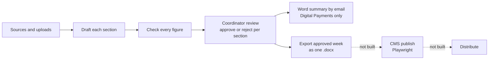
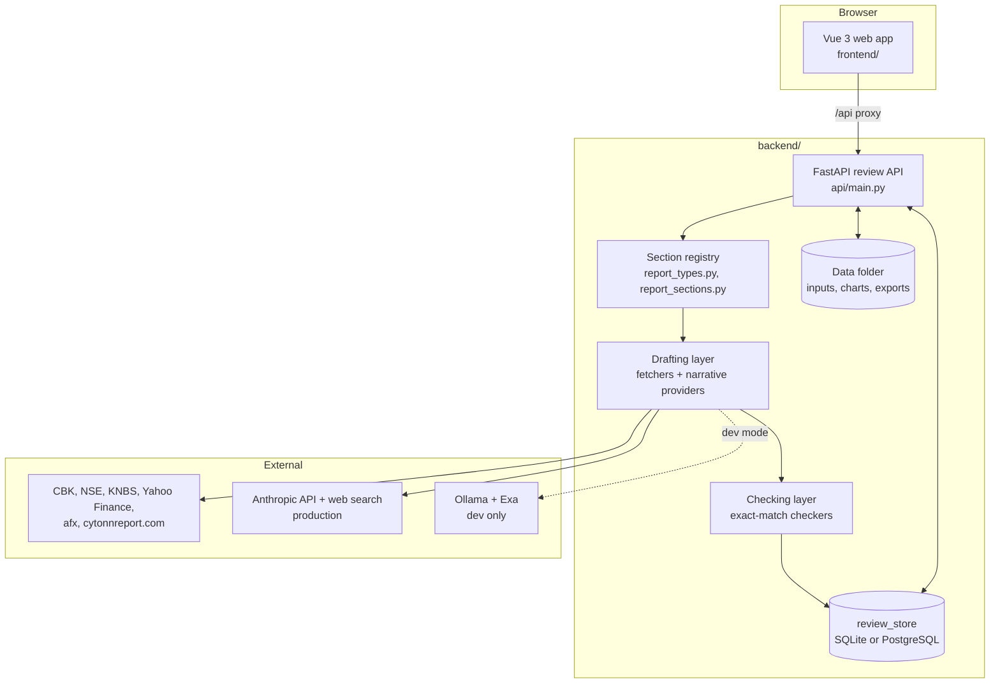

# Cytonn Weekly

Tooling to automate drafting, checking and publishing the Cytonn weekly report.

See [CLAUDE.md](CLAUDE.md) for full project context and the task backlog.

## Architecture & System Design

### What it does

The tool drafts the first version of the weekly Cytonn Weekly report. It pulls data from public sources and from the files the analysts send, maps it into the report's existing format, checks every figure, and hands a coordinator a draft to review instead of a blank page. The tool never approves anything: one coordinator approves each section.

### Process flow



### Components



| Layer | Where | Role |
| --- | --- | --- |
| Web app | `frontend/` | Vue 3, Vite, Tailwind, Reka UI. Derives nothing itself: it shows what the API returns. Overview, start screen, run view and review screen. |
| Review API | `backend/api/` | Stateless FastAPI. Each write loads the review fresh, changes it, saves it and returns the whole review. One draft runs at a time (`draft_slot.py`). No authentication yet. |
| Section registry | `report_types.py`, `report_sections.py` | One list per report type (weekly, quarterly, half-year, annual, companion). A review's key is (report type, period, section). |
| Drafting layer | `backend/src/cytonn_weekly/<section>/` | Per-section fetchers for tables, and an LLM provider for narrative, written only from search results with every claim cited. |
| Checking layer | `checkers/`, `common/checks.py` | Exact-match of every table figure and every claim's figures against the normalized source, with rounding half up. Missing parts become flags. |
| Review model | `coordinator_review.py`, `review_store.py` | `CoordinatorReview` with one item per figure, claim or missing part. Status (machine) is separate from resolution (coordinator). A decided review is frozen. |
| Weekly inputs | `weekly/` | Upload store, readers for the workbooks, KCB reports, CBK bulletin and NSE price list (OCR), the analyst inputs form, and the Word export. |
| Storage | `db.py`, `schema.sql` | SQLite by default, PostgreSQL (Supabase) when `CYTONN_DATABASE_URL` is set. Uploads, charts and exports are files under the data folder. |

### The six weekly sections

Company Updates (the coordinator's pasted text, carried verbatim), Fixed Income, Equities, Real Estate, Digital Payments and Focus of the Week. Digital Payments has its own content shape; every other section is built from generic blocks (`table`, `narrative`, `computed`, `carried`, `supplied`, `unavailable`). Both end as the same `CoordinatorReview`.

### Design decisions

- **Two layers, then a human.** Draft, then check, then one approve or reject per section.
- **Nothing is invented.** Every figure and claim traces to a source. A part the tool cannot source becomes an `unavailable` block that names the reason and what would unblock it.
- **Exact match, not a tolerance.** The source is normalized to the draft's display precision and then compared for equality. A mismatch (the draft differs from its source) and "sources disagree" (two sources differ) are different flags.
- **Analyst inputs are never clean.** A figure typed by an analyst or read from a workbook is shown as such and not auto-verified. A figure read by OCR needs a second source.
- **Dev mode cannot reach a recipient.** With `CYTONN_LLM_PROVIDER=local` every draft is marked `drafted_by: local:<model>`, the screen and the Word file carry a DEV MODE mark, and email and export refuse to send.
- **The run view shows only real events.** Builders emit run events (`common/run_events.py`) and the API streams them as Server-Sent Events. There is no simulated progress.
- **Report types share one pipeline.** Quarterly, half-year, annual and companion reports reuse the same review model, with their own section lists and period rules.
- **Publishing is browser automation.** Cytonn has granted no CMS API or database access, so publishing is a documented stub (`backend/api/cms_publish.py`) that nothing can reach.

### Not built yet

CMS publish (Playwright, behind SSO), sign-in with Cytonn SSO (a stub), the production-mode drafts (blocked on Anthropic API budget approval), citation verification of drafted claims, and several Markets Review parts that wait on samples or access. [CLAUDE.md](CLAUDE.md) lists each stub with what unblocks it.

## Setup

The project has two folders: `backend/` (Python: the package in `backend/src/`, the API in `backend/api/`, `backend/scripts/`, `backend/tests/`, `backend/data/`) and `frontend/` (the Vue 3 web app, built with Vite). `.env` stays in the repo root.

```sh
cd backend
python -m venv .venv
.venv\Scripts\activate        # Windows; use `source .venv/bin/activate` elsewhere
pip install -e .
playwright install chromium
python -m pytest -q            # the test suite
```

## Coordinator review screen (Digital Payments)

A FastAPI layer (`backend/api/`) over `review_store`, `review_run` and `coordinator_review`, and a Vue app (`frontend/`) that talks to it. Run both:

```sh
cd backend
uvicorn api.main:app --port 8000        # terminal 1: the API (loads the repo-root .env at startup)
cd frontend && npm ci                   # terminal 2, first time only
npm run dev                             # terminal 2: the web app, at http://127.0.0.1:5173 (landing page; the overview is /overview)
```

The browser only talks to the web app's own address: its server proxies `/api` to the API at `VITE_API_TARGET` (default `http://127.0.0.1:8000`; set it in the shell before `npm run dev` to use another instance). For a page served from elsewhere, the API accepts browser requests from `http://localhost:5173` and `http://127.0.0.1:5173`; set `CYTONN_WEB_ORIGINS` (comma-separated) to allow another origin. The API has no authentication of its own, so keep it on localhost or behind the SSO'd network.

The screen's "Draft this week's section" button runs the real pipeline (price fetch, drafting, checks) and loads the result. That uses the drafting provider below, so the default Anthropic provider spends API budget; `CYTONN_LLM_PROVIDER=local` is the free dev option (output not for publication, and the screen says so). A draft takes minutes. It is saved on the server when it finishes even if the browser gives up waiting, and only one draft runs at a time.

The review is saved to `backend/data/app.db` (table `coordinator_reviews`, defined in `backend/src/cytonn_weekly/schema.sql`) when the draft lands, on every resolution change, and on the decision. After a refresh, the start screen offers to resume today's saved review instead of re-drafting; a decided review is frozen and can only be viewed. Code that needs the approved values reads them with `review_store.load_latest_review()`.

Endpoints, all under `/api` (see `backend/api/main.py`): `GET /config`, `GET /reviews/latest?run_date=today`, `GET /reviews/{run_id}`, `POST /reviews/draft`, `PATCH /reviews/{run_id}/items/{index}`, `POST /reviews/{run_id}/accept-clean`, `POST /reviews/{run_id}/decide`. A rejected write (not approvable, already decided) is a 409.

## Run with Docker

Docker Desktop must be running first (on Windows, start it and wait until it says the engine is running). Run from the repo root, in PowerShell. `.env` must hold `CYTONN_DATABASE_URL`: the Docker app uses the same Supabase database as the native one and refuses to start without it (it never falls back to SQLite).

```powershell
docker compose up -d --build        # build the two images and start them in the background
docker compose ps                   # both should say "healthy" (web waits for api)
docker compose logs --tail 50 api   # the API's last 50 lines
docker compose down                 # stop both
```

Then open http://127.0.0.1:5173 (the API is at http://127.0.0.1:8000), the same addresses as a native run. **Run one copy at a time**: stop the native API and `npm run dev` before starting Docker, and `docker compose down` before running natively, or the ports clash. Both are reachable from this machine only: the app has no sign-in, so the ports are published on 127.0.0.1 and must stay there.

- **Files:** `backend/data` is bind-mounted into the API container, so inputs, charts, exports and the search cache are the same files as a native run. There is no Docker volume and nothing to copy.
- **Secrets:** they reach the container from `.env` at run time only (`env_file`), never an image. Never run `docker compose config` without `--quiet` or `--no-env-resolution`: it prints what `.env` holds.
- **Web:** the built app is served by nginx (`frontend/nginx.conf`), which proxies `/api` to the API, the run view's live stream included.
- **Tests** are not in the runtime image. `docker build --target test -t cytonn-api-test backend` then `docker run --rm --network none cytonn-api-test` runs the suite without `.env` or the data folder.
- **Development override** (`docker compose -f docker-compose.yml -f docker-compose.dev.yml up --build`): source mounted, both servers reload. Updated for nginx but not yet run.
- **On the shared server** the images are built elsewhere and loaded from a tarball, because that box cannot build them without risking its other workloads. See [deploy/README.md](deploy/README.md); never run `--build` there.
- The local development model (Ollama) stays on the host; the container reaches it at `http://host.docker.internal:11434`.

## Drafting provider (Digital Payments)

`CYTONN_LLM_PROVIDER` picks who drafts the Weekly Highlights and outlook: `anthropic` (default, production) or `local` (development only, prints a NOT FOR PUBLICATION warning).

Local mode uses Ollama for drafting and Exa (`EXA_API_KEY`) for search:

```sh
ollama pull phi4-mini                         # default model, ~2.5 GB
CYTONN_LLM_PROVIDER=local python scripts/check_digital_payments_highlights_live.py   # from backend/
```

To A/B another model on the same search results, set `CYTONN_LOCAL_MODEL`, e.g. `gemma4:26b-a4b-it-qat` (a ~15.6 GB pull; needs well over 16 GB of free RAM or a large GPU). The first run saves each company's Exa results to `backend/data/exa_cache/<company>_<date>.json`, and later runs, whatever the model, reuse them. The cache is keyed by calendar day, so compare models on the same day. **To force a fresh Exa pull**, set `CYTONN_EXA_REFRESH=1`, or delete the file (or the whole `backend/data/exa_cache/` directory).

