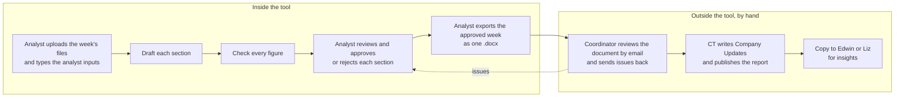
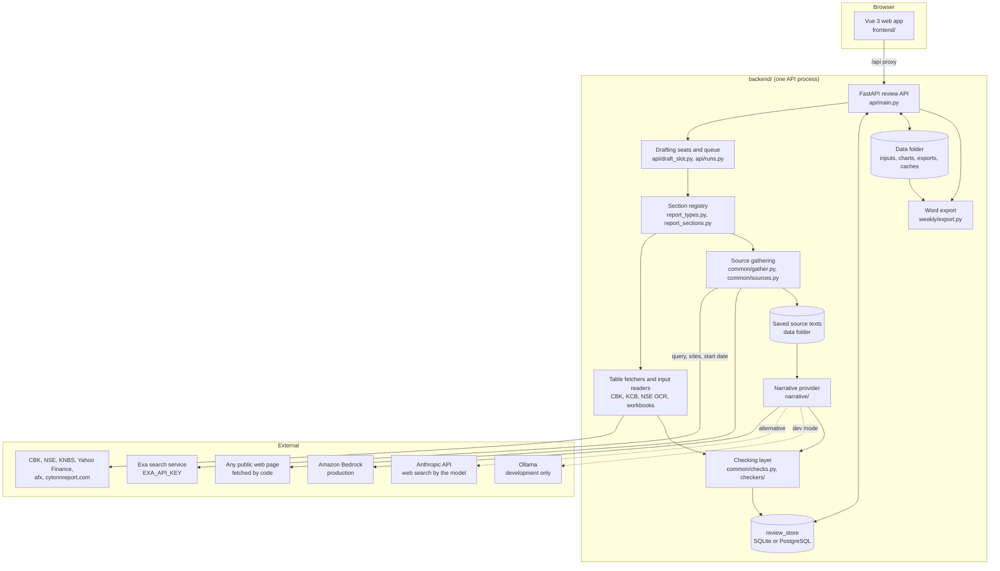

# Cytonn Weekly

Tooling to draft and check the weekly Cytonn Weekly report, so an analyst reviews a draft instead of starting from a blank page.

See [CLAUDE.md](CLAUDE.md) for full project context and the task backlog.

## Architecture & System Design

### What it does

The tool drafts the first version of each weekly section. It pulls data from public sources and from the files the analysts send, maps it into the report's existing format, checks every figure, and hands an analyst a draft to review. The tool never approves anything: an analyst approves each section, and the approved week is exported as one Word file. Publishing happens outside the tool.

### Process flow



Everything after the export is done by people, outside the tool. Nothing in the tool sends the export, publishes it or distributes it.

### Components



| Layer | Where | Role |
| --- | --- | --- |
| Web app | `frontend/` | Vue 3, Vite, Tailwind, Reka UI. Derives nothing itself: it shows what the API returns. Landing page, overview, start screen, run view, review screen, a Sources panel (Bedrock), and a read-only Previous reports page. |
| Review API | `backend/api/` | FastAPI in one process. Each write loads the review fresh, changes it, saves it and returns the whole review. Drafts run as background runs whose real steps stream to the run view. No authentication. |
| Section registry | `report_types.py`, `report_sections.py` | One section list per report type. A review's key is (report type, period, section). |
| Input readers | `backend/src/cytonn_weekly/weekly/` | Upload store, readers for the analysts' workbooks, KCB IB reports, the CBK Weekly Bulletin, the NSE price list (OCR) and yield curve, the analyst inputs form, the charts and the Word export. |
| Table fetchers | `<section>/` packages | Per-section fetchers (Yahoo Finance, CBK result files, Ibuka REIT summary and so on). Tables and computed paragraphs need no model. |
| Source gathering | `common/gather.py`, `common/sources.py` | Finds and saves the pages a Bedrock draft is written from. See below. |
| Narrative providers | `narrative/`, `digital_payments/providers/` | Write the cited narrative. `CYTONN_LLM_PROVIDER` picks one. See below. |
| Checking layer | `common/checks.py`, `checkers/` | Exact-match of every table figure against its normalized source (rounding half up), a check of every claim's figures against its cited text, and a flag for every missing part. |
| Review model | `digital_payments/coordinator_review.py`, `review_store.py` | `CoordinatorReview` with one item per figure, claim or missing part. Status (machine) is separate from resolution (analyst). A decided review is frozen. |
| Storage | `db.py`, `schema.sql`, `schema_postgres.sql` | SQLite by default, PostgreSQL (Supabase) when `CYTONN_DATABASE_URL` is set. Uploads, saved sources, charts and exports are files under the data folder. |

### Drafting providers

`CYTONN_LLM_PROVIDER` selects who writes the narrative (the Weekly Highlights, Real Estate themes, Focus of the Week and the outlooks). Unset means `anthropic`.

| Value | What it is | Use |
| --- | --- | --- |
| `bedrock` | Claude on Amazon Bedrock through the `AnthropicBedrock` client (`anthropic[bedrock]`). The reply is forced into JSON through a client-side `submit_draft` function call. The model is `BEDROCK_MODEL_ID` (default `us.anthropic.claude-sonnet-4-6`); AWS region and credentials come from the `AWS_*` variables. | Production. |
| `anthropic` | The Anthropic API with Anthropic's server-side web search, model set by `CYTONN_LLM_MODEL`, key `ANTHROPIC_API_KEY`. | Default when the variable is unset. Kept in the code. |
| `local` | Ollama (default model `phi4-mini`) with Exa for search. Every piece is marked `drafted_by: local:<model>`, the screen and Word file carry a DEV MODE mark, and email and export refuse to send. | Development only. |

Bedrock has no search or fetch tool the code can use, and the model is given none. It writes only from source text that code hands it.

### Source gathering (Bedrock drafts)

1. At the start of a run, each piece of the section (for example one Real Estate theme, or one Digital Payments company) that has fewer than `CYTONN_SOURCES_ENOUGH` saved sources is searched with Exa (`EXA_API_KEY`). The query is the piece's label plus a market name (`CYTONN_SOURCES_MARKET`, default Kenya; none for Digital Payments), optionally limited to the sites the brief prefers, with the start of the piece's date window.
2. **What goes to Exa:** the query text, the site restriction, the start date and the API key. **What does not:** uploaded files, workbook or analyst figures, draft text or saved source text. Results come back as addresses, dates and page text.
3. Code fetches the best pages itself (`common/sources.py`). Any public site can be fetched. Refused: a scheme other than http or https, a port other than 80 or 443, a username or password in the address, social media, any host that is or resolves to a private, loopback, link-local or reserved address (checked again on every redirect), a redirect to another host, more than 3 redirects, a page over 5 MB, anything that is not HTML or a PDF, a 20 second timeout, login or paywall pages and pages too short to be an article. TLS is always verified. A host that is not on the known-sites list is allowed but flagged, and an http page is flagged as not secure.
4. Analysts can add a link (fetched the same way) or paste text with its address and date, from the Sources panel on the section's start screen. Social media is never accepted.
5. Each source is saved with its address, date, fetch time and a hash of its text, and the hash is checked on every read.
6. Bedrock is given the saved texts and returns claims, each with a quote and a source. A claim is kept only if the source is one that was supplied, the quote is in that source's saved text word for word (after normalizing whitespace and quote marks), and every number in the claim appears in the quote. Anything else is dropped with a warning. The wording around the numbers is not verified, so a kept claim is still marked not auto-verified for the analyst.
7. With no `EXA_API_KEY` nothing is searched and the run says so; drafting goes on with the sources already saved. A piece with no sources is reported as having none and Bedrock is not called for it.

Focus of the Week on Bedrock needs the analyst to type the section titles, since there is nothing to search for a proposed outline.

### The weekly sections

Fixed Income, Equities, Real Estate, Digital Payments and Focus of the Week, in that order. Company Updates is written by the CT team after the exported document is received and before publishing, so the tool does not draft it.

- **Fixed Income and Equities** are worked out from the week's inputs: the CBK Weekly Bulletin, CBK's auction results and daily rates, KCB IB's trading reports, the NSE daily price list, and the analysts' own figures. Narrative highlights are cited.
- **Real Estate**: rotating themed subsections plus the Ibuka REITs table.
- **Digital Payments**: a Yahoo Finance stock table, up to four highlights, the outlook and an exact-match check of the table. An optional Digital Payments workbook can be uploaded; it changes no printed figure and only adds reviewer warnings and review items.
- **Focus of the Week**: the analyst types the topic (and optionally the section titles). The tool drafts the lead, numbered sections and conclusion, and carries the disclaimer from the previous issue. Cytonn's own tables and charts are the analyst's.

Digital Payments has its own content shape; every other section is built from generic blocks (`table`, `narrative`, `computed`, `carried`, `supplied`, `unavailable`). Both end as the same `CoordinatorReview`.

### Weekly inputs

The analyst picks the week on the overview ("Week to draft": the coming Friday and the last eight; a fully approved week stays usable, and Previous reports is the read-only archive). The start screens of Fixed Income and Equities take the week's uploads: the equities and fixed income workbooks (optional), KCB IB's daily and weekly reports, the CBK Weekly Bulletin (upload or "Fetch from CBK") and, optionally, the NSE yield curve. Each upload is checked by content before it is kept and shows the date read from the file.

- **Weekly analyst inputs form.** Figures that exist only in the analysts' workbooks can be typed instead, per week. Examples are the Bloomberg P/E and dividend yield, the money market fund table (pasted from the Daily Nation e-paper), bank placements and the Universe of Coverage inputs. Typed values are always shown as analyst input and never counted as clean. "Start from last week's form" carries values forward, and a carried weekly figure is not used until the analyst confirms it.
- **NSE price list.** It is a scanned image. It is read with OCR (`rapidocr-onnxruntime`), a figure is kept only if two readings agree, and an OCR figure needs a second source to count as clean. Readings are cached per PDF in the data folder.
- **CBK result files** are downloaded once, kept, and checked against CBK on later runs.

### Concurrency

Several analysts can draft at once. `CYTONN_DRAFT_CONCURRENCY` (default 3, 1 to 6) is how many drafts that call the model run at the same time; more wait in a queue of up to `CYTONN_DRAFT_QUEUE_MAX` (default 20, then a draft is refused). One section of one report and period runs at a time. The seats, queue and run list are in the memory of one API process, so the API must run as one process and a restart loses runs in progress (saved reviews are kept). Bedrock throttling is retried with a growing wait (`CYTONN_BEDROCK_RETRIES`, `CYTONN_BEDROCK_RETRY_BASE_SECONDS`).

### Report types

The weekly report is the built one. The registry also holds the quarterly (Q1, Q3), half-year and annual Markets Reviews, the companion research reports and the Cytonn Monthly. The Markets Reviews have working parts (for example the Bond Issuances table, the inflation table, the period Digital Payments table) and many parts that are `unavailable` blocks naming what they wait on. Every section of a Monthly and of a companion report is a stub that cannot be drafted. The Word export is weekly only.

### Design decisions

- **Two layers, then a human.** Draft, then check, then one approve or reject per section.
- **Nothing is invented.** Every figure and claim traces to a source. A part the tool cannot source becomes an `unavailable` block that names the reason and what would unblock it.
- **Exact match, not a tolerance.** The source is normalized to the draft's display precision and then compared for equality. A mismatch (the draft differs from its source) and "sources disagree" (two sources differ) are different flags.
- **Analyst inputs are never clean.** A figure typed by an analyst or read from a workbook is shown as such and not auto-verified.
- **Carried text is flagged.** Text carried from the previous issue is always flagged for editing.
- **Dev mode cannot reach a recipient.** Drafts from the local model are marked and email and export refuse them.
- **The run view shows only real events.** Builders emit run events (`common/run_events.py`) and the API streams them as Server-Sent Events. There is no simulated progress.
- **The tool never approves anything.** Approval is one analyst per section.

### Not built yet

- **CMS publish.** `backend/api/cms_publish.py` is a documented stub that nothing can reach. CT publishes by hand.
- **Sign-in with Cytonn SSO.** `backend/api/sso.py` is a stub. The app has no accounts and does not record who approved a section. On the production host a shared password in front of the app is the only gate (see Deployment).
- **Distribution** of the published report.
- **Company Updates.** Not drafted by the tool, by design.
- **Verification of drafted wording.** Only figures and, on Bedrock, the quotes are checked. A written Executive Summary is not drafted by a model; Markets Review summaries are composed from approved pieces.
- **Focus of the Week topic suggestion.** The analyst types the topic.
- **Most charts.** Only the NASI P/E and NASI dividend yield charts are drawn from the workbook. The others are placeholders in the Word file for the team to add.
- **Notable this week.** The panel, saved decisions and detector library exist, but no detector is registered and there is no history store, so the real panel is empty.
- **Parts that wait on samples or access** (Markets Review parts such as the Universe of Coverage, the SSA currency and Eurobond tables, the Monthly and the companion reports). [CLAUDE.md](CLAUDE.md) lists each stub with what unblocks it.
- **Langfuse tracing.** A separate compose file starts it, but nothing in the app sends traces yet.
- **Email of the weekly export.** A Word summary email exists for Digital Payments only (`backend/scripts/send_weekly_summary.py`); the weekly export is handed to the analyst, not sent.

## Setup

The project has `backend/` (Python: the package in `backend/src/`, the API in `backend/api/`, `backend/scripts/`, `backend/tests/`, `backend/data/`), `frontend/` (the Vue 3 web app, built with Vite) and `e2e/` (Playwright). `.env` stays in the repo root; `.env.example` lists every variable the code reads.

Python 3.11 or later is needed (developed on 3.12). Node 22 is the version the Docker image uses.

```sh
cp .env.example .env           # then fill in what you need
cd backend
python -m venv .venv
.venv\Scripts\activate         # Windows; use `source .venv/bin/activate` elsewhere
pip install -e ".[test]"       # the test extra holds pytest and pytest-xdist
python -m pytest -q            # the backend test suite
```

Frontend, from `frontend/`: `npm ci`, then `npm run dev`, `npm run lint`, `npm run typecheck`, `npm test` (Vitest) and `npm run build`. The end-to-end suite is in `e2e/`; its set-up and the way it isolates itself from the real database are in [e2e/README.md](e2e/README.md).

## Run the app

A FastAPI layer (`backend/api/`) over `review_store` and the section builders, and a Vue app (`frontend/`) that talks to it:

```sh
cd backend
uvicorn api.main:app --port 8000        # terminal 1: the API (loads the repo-root .env at startup)
cd frontend && npm ci                   # terminal 2, first time only
npm run dev                             # terminal 2: the web app, http://127.0.0.1:5173 (landing page; the overview is /overview)
```

The browser only talks to the web app's own address: its server proxies `/api` to the API at `VITE_API_TARGET` (default `http://127.0.0.1:8000`; set it in the shell before `npm run dev` to use another instance). For a page served from elsewhere, the API accepts browser requests from `http://localhost:5173` and `http://127.0.0.1:5173`; set `CYTONN_WEB_ORIGINS` (comma-separated) to allow another origin. The API has no authentication of its own, so keep it on localhost or behind something that authenticates.

A draft takes minutes and is saved on the server when it finishes, even if the browser is closed. Reviews are saved to `backend/data/app.db` (SQLite) or to PostgreSQL when `CYTONN_DATABASE_URL` is set. Reviews, resolutions and decisions are saved as they change. The routes are in `backend/api/main.py`; the main groups are `/api/sections`, `/api/runs`, `/api/reviews`, `/api/inputs/weekly`, `/api/sources`, `/api/export/weekly`, `/api/previous/weekly`, `/api/notable`, `/api/config` and `/api/health`.

## Run with Docker

Docker Desktop must be running first. Run from the repo root, in PowerShell. `.env` must hold `CYTONN_DATABASE_URL`: the Docker app uses the same Supabase database as the native one and refuses to start without it (it never falls back to SQLite).

```powershell
docker compose up -d --build        # build the two images and start them in the background
docker compose ps                   # both should say "healthy" (web waits for api)
docker compose logs --tail 50 api   # the API's last 50 lines
docker compose down                 # stop both
```

Then open http://127.0.0.1:5173 (the API is at http://127.0.0.1:8000), the same addresses as a native run. **Run one copy at a time**: stop the native API and `npm run dev` before starting Docker, and `docker compose down` before running natively, or the ports clash. Both ports are published on 127.0.0.1 only and must stay there: the app has no sign-in.

- **Images:** `api` is the `runtime` stage of `backend/Dockerfile` (Python 3.12, with the system libraries the OCR needs and the Carlito font for charts). `web` is the `runner` stage of `frontend/Dockerfile`: it builds the app and serves it with `vite preview`, which proxies `/api` to the API.
- **Files:** `backend/data` is bind-mounted into the API container, so inputs, saved sources, charts, exports and the search cache are the same files as a native run.
- **Secrets:** they reach the container from `.env` at run time only (`env_file`), never an image. Never run `docker compose config` without `--quiet` or `--no-env-resolution`: it prints what `.env` holds.
- **SQLite on this machine:** `docker compose -f docker-compose.yml -f docker-compose.local.yml up -d --build` runs the same stack on a SQLite file in a Docker volume, so the real database and `backend/data` are not touched.
- **Tests** are not in the runtime image. `docker build --target test -t cytonn-api-test backend` then `docker run --rm --network none cytonn-api-test` runs the backend suite without `.env` or the data folder.
- **Development override:** `docker compose -f docker-compose.yml -f docker-compose.dev.yml up --build` mounts the source and reloads both servers.
- **Langfuse:** `docker-compose.langfuse.yml` starts a self-hosted Langfuse with its own databases, on 127.0.0.1 only. The app does not use it yet.
- **Local model:** Ollama stays on the host; the container reaches it at `http://host.docker.internal:11434`.

## Deployment

Details are in [deploy/DEPLOY.md](deploy/DEPLOY.md) and [deploy/README.md](deploy/README.md). The production host is a shared server that cannot build the images, so it only pulls them.

1. **Build and publish.** The **Publish images** workflow (`.github/workflows/publish-images.yml`) runs on every push to `main` (and by hand). It builds the `api` (`runtime`) and `web` (`runner`) images for linux/amd64 and pushes them to GitHub Container Registry as `cytonn-weekly-api` and `cytonn-weekly-web`, tagged `sha-<short commit>` and `latest`.
2. **Run.** On the host, `docker-compose.yml` plus `deploy/docker-compose.server.yml` start the stack. The override pulls the published images and never builds, sets memory limits, publishes the api and web ports on the host's loopback only, and passes the Bedrock, Exa and draft-concurrency variable names through from the server's `.env`. `.env` and `.env.proxy` exist only on the server and are never in an image or the repo.
3. **Deploy.** `deploy/deploy.sh [tag]` pulls the compose files (if the folder is a git clone), pulls the `api` and `web` images, recreates those two services and prints their status. `./deploy.sh sha-<commit>` rolls back to that build. After editing `.env`, run `docker compose up -d --force-recreate api`: a restart does not re-read it.
4. **Reverse proxy and sign-in.** A Caddy container (`deploy/Caddyfile`, image built from `deploy/Dockerfile.proxy`) is the only service reachable from outside. It listens on 443, gets its certificate by DNS challenge, asks for one shared password (HTTP basic auth, set in `.env.proxy` through `SITE_DOMAIN`, `BASIC_AUTH_USER`, `BASIC_AUTH_HASH` and the DNS provider token) and forwards to the web container. This is a gate, not an identity: it does not record who approved a section. It stays until Cytonn SSO is unblocked.
5. **Production settings.** The production host drafts with `CYTONN_LLM_PROVIDER=bedrock`, so it needs the `AWS_*` variables, `BEDROCK_MODEL_ID` and `EXA_API_KEY` in its `.env`. A runbook for testing a Bedrock draft on the host is `deploy/bedrock-droplet-test.md`.
